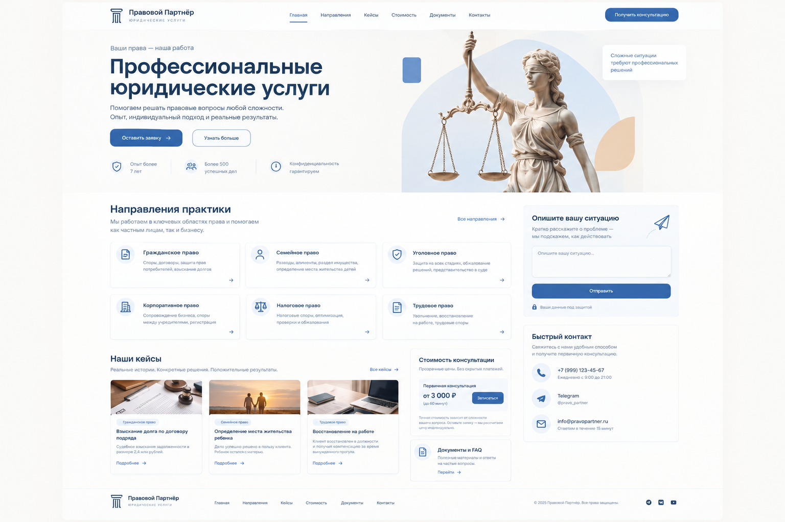

# Правовой Партнёр — лендинг юридической компании

Одностраничный сайт юридической компании «Правовой Партнёр», свёрстанный по макету внизу: деловая тёмно-синяя айдентика, статуя Фемиды в hero-блоке, шесть направлений практики, блок стоимости, кейсы, документы, FAQ и форма заявки. Вся интерактивность — на чистом JavaScript без сборки и зависимостей: модальные окна (заявка, направление, кейс, документ), валидация форм с маской телефона, FAQ-аккордеон, бургер-меню, плавный скролл со scroll-spy и анимации появления. Заявки сохраняются в `localStorage`, бэкенд не требуется. Вёрстка полностью адаптивная до 390 px, шрифт Manrope подключается с Google Fonts.

| | |
|---|---|
| **Функции** | Модальные окна, форма заявки с валидацией и маской телефона, FAQ-аккордеон, бургер-меню, плавный скролл, анимации появления, скачивание PDF-документов |
| **Технологии** | HTML5, CSS3, vanilla JS, inline SVG-иконки, Manrope (Google Fonts) — без сборки и зависимостей |
| **Запуск** | Открыть `index.html` в браузере или выполнить `python -m http.server` в папке проекта |
| **Структура** | `index.html`, `styles.css`, `main.js`, `img/` — фото кейсов и Фемида, `docs/` — PDF-шаблоны |
| **Демо** | https://ner1z.github.io/pravovoy-partner/ |

**Макет:**

